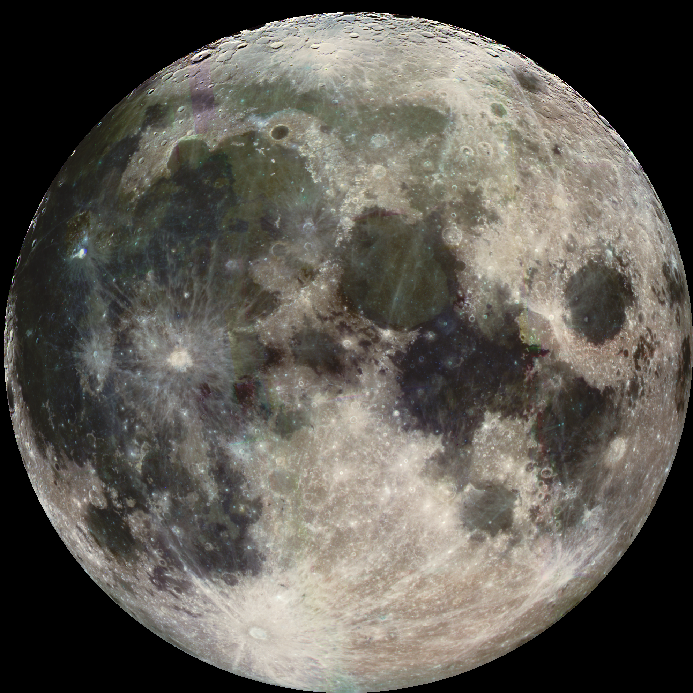
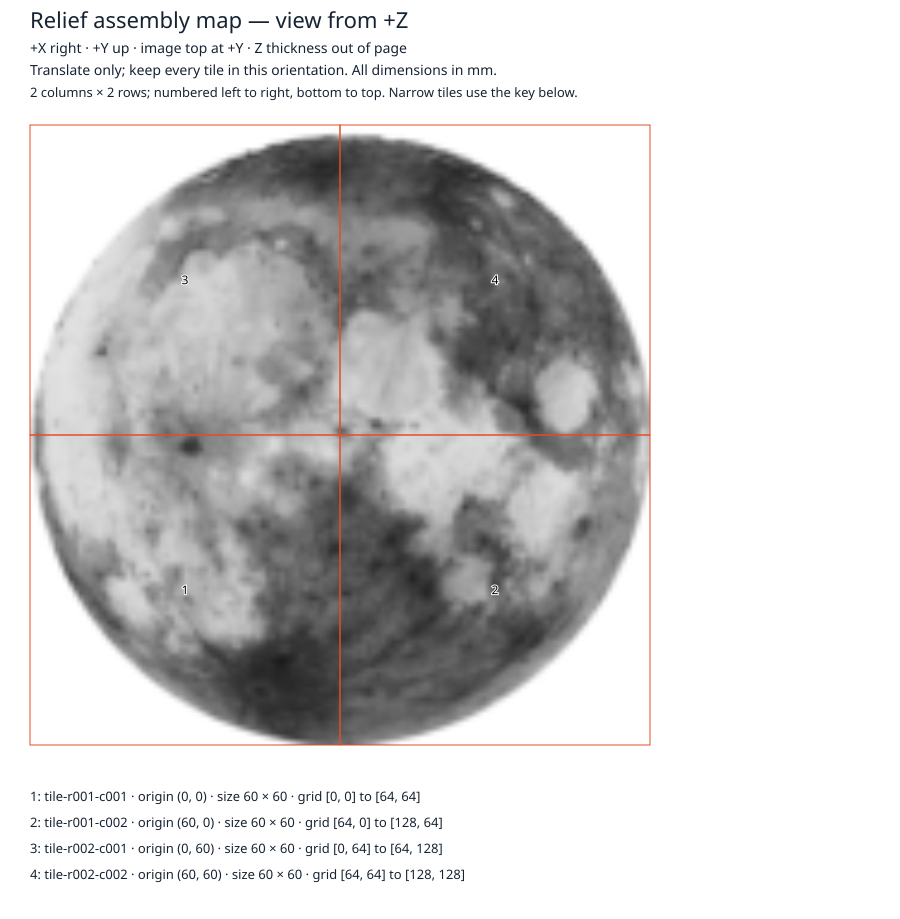
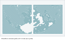

# A real photograph to a two-bed lithophane

Use the included [Galileo Moon photograph](../examples/moon/README.md) to make a
**120 × 120 mm** flat lithophane in **four 60 × 60 mm tiles**. Dark image regions
are thicker: the configured thickness is 0.8–3.2 mm. This is brightness-to-thickness
mapping, not lunar topography. The image, launch path and validation work offline
after installing dependencies.



## Launch

From the repository root, install the development requirements (including
Trimesh and lib3mf) as described in the README. Install **PrusaSlicer** separately;
this example was inspected with Ubuntu 24.04's `prusa-slicer` package
`2.7.2+dfsg-1build2`. Its CLI reports `PrusaSlicer-2.7.2+UNKNOWN`. No display,
printer connection, paid service or account is required. On Ubuntu, an administrator
can install the package with `apt install prusa-slicer`; it is not a Python package.

```sh
.venv/bin/python scripts/demo_moon.py --output outputs/my-moon
```

Pass `--slicer /path/to/prusa-slicer` if it is not on PATH. Choose a **new** output
directory. Omit `--output` for a temporary verification run. The script fails if
the slicer is unavailable; it never silently substitutes a mock or skips slicing.
This check takes longer than conversion because it repeats both bundles and
slices both beds. It needs the checkout's `examples/` assets.

For conversion alone, without a slicer or Trimesh, install `.[three-mf]` and run:

```sh
.venv/bin/python -m image_relief_forge convert examples/moon/source.png \
  --output outputs/moon-tiles --width 120 --base 0.8 --relief 2.4 \
  --resolution 129 --mode lithophane --max-tile-width 60 --max-tile-height 60 --3mf
.venv/bin/python -m image_relief_forge layout outputs/moon-tiles \
  --output outputs/moon-beds --bed-width 133 --bed-height 75 \
  --margin 5 --clearance 3 --rotate
.venv/bin/python -m image_relief_forge validate-layout outputs/moon-beds
```

Resolution 129 makes 128 equal grid cells, so the midpoint falls exactly on a
sample and produces four equal tiles without narrow remainder strips.

## Preview and inspect

Open `outputs/my-moon/tiles/assembly.svg` in a browser for the image, tile labels
and assembly positions. Open `beds/bed-001.svg` and `beds/bed-002.svg` for bed
placements. `slicer/bed-001-layer.svg` and `slicer/bed-002-layer.svg` show actual
PrusaSlicer extrusion centerlines at Z=1.6 mm, with travel moves omitted. These
are toolpath diagrams, not photographs of prints or optical simulations.

The generated `tiles/` folder contains individual STLs and `model.3mf` in assembly
coordinates; use the **bed-specific** `beds/bed-001.3mf` and `bed-002.3mf` to slice
individual beds. Each bed is 133 × 75 mm with 5 mm minimum edge margin and 3 mm
between tiles. The occupied area is X=5..128, Y=5..65 mm. Each tile appears once;
the bed layout must not be auto-arranged, scaled or centered during import.
For a desktop inspection, open a bed-specific 3MF as geometry, retain coordinates,
select your printer/material profile and check the size and placement before
slicing. If the slicer rearranges it, restore the manifest coordinates or use the
CLI inspection below. Desktop GUI behavior was not tested in this run.

The automated check uses the independent PrusaSlicer CLI with `--dont-arrange`.
For each bed it imports the 3MF, checks `--info` dimensions/manifold status,
re-exports STL, compares every triangle against the source tiles transformed to
bed positions, then generates G-code using [inspection.ini](../examples/moon/inspection.ini).
The triangle comparison ignores face/vertex ordering and rounds to 0.00001 mm;
it does not repair either mesh. Trimesh also checks the original STLs using exact
vertex indexing. The existing lib3mf validator independently checks units,
transforms, completeness, clearance and assembly reconstruction.

G-code inspection checks all 16 layer heights (0.2..3.2 mm), positive extrusion
on both assigned tiles, and that every extruding segment remains within one
tile footprint. It rejects extrusion across the gap. This parser supports the
explicit inspection profile's absolute-mm XYZ and relative-E linear motion;
it is not a general G-code validator. Full conversion and layout bundles are
repeated and compared byte-for-byte. G-code contains timestamps and is not
claimed deterministic.

## Assemble and print responsibly

The assembly is a 2 × 2 square viewed from +Z, with image top at +Y:

| Position | Tile | Bed | Bed lower-left (mm) | Assembly lower-left (mm) |
| --- | --- | --- | --- | --- |
| bottom left | r001-c001 | 1 | (5, 5) | (0, 0) |
| bottom right | r001-c002 | 1 | (68, 5) | (60, 0) |
| top left | r002-c001 | 2 | (5, 5) | (0, 60) |
| top right | r002-c002 | 2 | (68, 5) | (60, 60) |

Keep the flat backs down and the textured sides up. Label each tile as it comes
off the bed; filenames and the assembly map are the identity key. Do not mirror
or rotate these tiles during assembly. Arrange edges together in a square;
there are no built-in tabs, registration pins, frame, assembly gaps or adhesive
allowances. A separate backing/frame and physical fit test are needed. Seams
will remain visible and actual fit depends on printer/material tolerances.

The generic inspection uses a 0.4 mm nozzle, 0.2 mm layers, 100% rectilinear infill,
two perimeters, no support, brim or skirt, and simultaneous (not sequential)
printing. This establishes that the meshes can be sliced, not that these settings
are optimal. **Do not send the generated inspection G-code to a printer.** Select
a profile for the actual printer, material, temperature, extrusion and start/end
routines, then re-slice. Reserve additional spacing for adhesion features and
hardware clearance; the geometric margin does not cover them. Flat lithophanes
show layer stepping; optical quality and image detail need physical trials.
No physical printing, light-transmission test, printer safety validation or GUI
slicer inspection has occurred.

## Saved inspection evidence

[Assembly preview](moon/assembly.svg), [bed 1 placement](moon/bed-001.svg),
[bed 2 placement](moon/bed-002.svg), [bed 1 sliced layer](moon/bed-001-layer.svg),
and [bed 2 sliced layer](moon/bed-002-layer.svg) are saved from the reproducible run.
The [machine-readable measurements](../results/moon-inspection.json) record
package hashes, all layer heights, extrusion counts and bounds, source volumes,
and the slicer roundtrip results. Each re-export contained 33,792 triangles;
every triangle matched the original tile geometry at its bed placement.
The full STL/3MF/G-code bundles are generated by the launch command rather than
checked in. The G-code hashes identify that run, not reproducible timestamp-free bytes.




